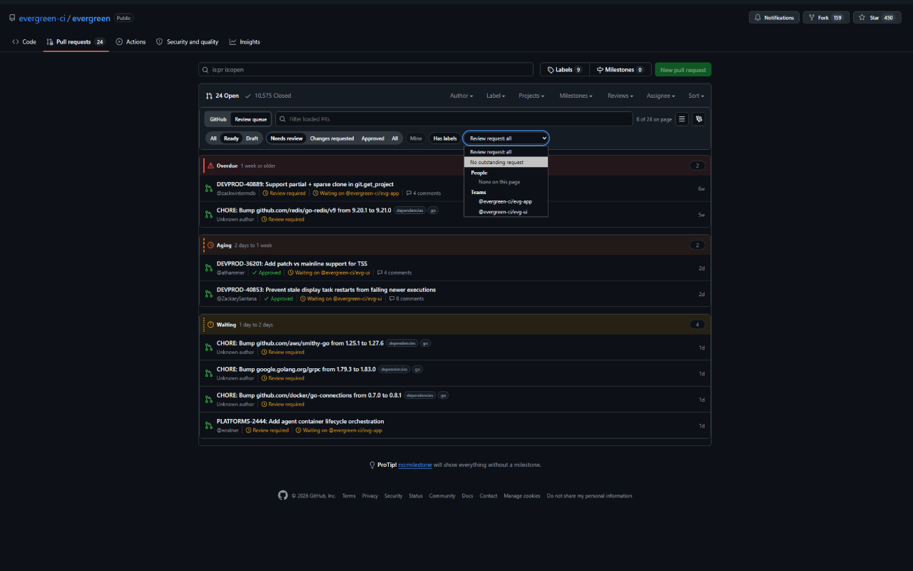

# gitreview

Chrome and Firefox extension that provides an enhanced GitHub pull requests page. It adds
an age-based review queue, focused local filters, review status, requested-team
context, and convenient navigation between newer and older PR pages. It works
on both GitHub's classic pull request list and the refreshed list view.



## Install

- [Chrome Web Store](https://chromewebstore.google.com/detail/gitreview/gpijjioiifphidajgdlaecplcddgfcjd)
- [Firefox Add-ons](https://addons.mozilla.org/firefox/addon/gitreview/)

## Build

```bash
npm ci
npm run build          # Chrome: bundles to .output/chrome-mv3/
npm run build:firefox  # Firefox: bundles to .output/firefox-mv3/
npm run dev            # development build with WXT
```

## Package For Stores

```bash
npm run zip          # .output/gitreview-<version>-chrome.zip for the Chrome Web Store
npm run zip:firefox  # .output/gitreview-<version>-firefox.zip and -sources.zip for AMO
```

AMO reviewers rebuild the Firefox package from the sources zip with Node 24:
`npm ci && npm run zip:firefox`. The output in `.output/firefox-mv3/` matches
the submitted package.

## Load In Chrome

1. Open `chrome://extensions` and enable **Developer mode**.
2. Choose **Load unpacked** and select `.output/chrome-mv3`.
3. Visit a repository pull-request page such as
   <https://github.com/evergreen-ci/evergreen/pulls>.

## Load In Firefox

Firefox 140 or newer is required.

1. Open `about:debugging#/runtime/this-firefox`.
2. Choose **Load Temporary Add-on** and select
   `.output/firefox-mv3/manifest.json`.
3. Visit a repository pull-request page.

The age queue works without a token. Optionally open queue settings and add a
fine-grained GitHub token with read-only **Pull requests** and
**Metadata** access for reliable approval state and private requested teams.
Firefox asks for permission to share the token and loaded PR numbers with
GitHub when the token is saved.

## Tests

```bash
npm run lint
npm run lint:firefox
npm run typecheck
npm test
npm run test:e2e
npm run build
```

## Layout

```text
entrypoints/background.ts       GitHub API enrichment and private-team fallback
entrypoints/github.content.tsx  GitHub content script and Shadow DOM mount
entrypoints/options/            optional token settings
src/github/                     GitHub page parser and API messaging
src/domain/                     pure filtering and age-zone logic
src/storage/                    synchronized settings and tab-scoped filters
assets/                         extension styles and brand artwork
tests/                          unit, component, parser, and browser tests
```

## Privacy

gitreview has no analytics, advertising, remote code, or project-operated
server. Optional tokens stay in the browser's local extension storage and are sent
only to GitHub. See [PRIVACY.md](PRIVACY.md) and [SECURITY.md](SECURITY.md).

## License

[MIT](LICENSE)
